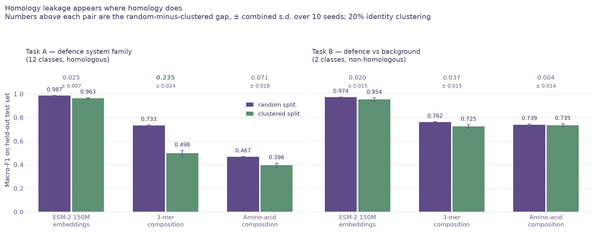
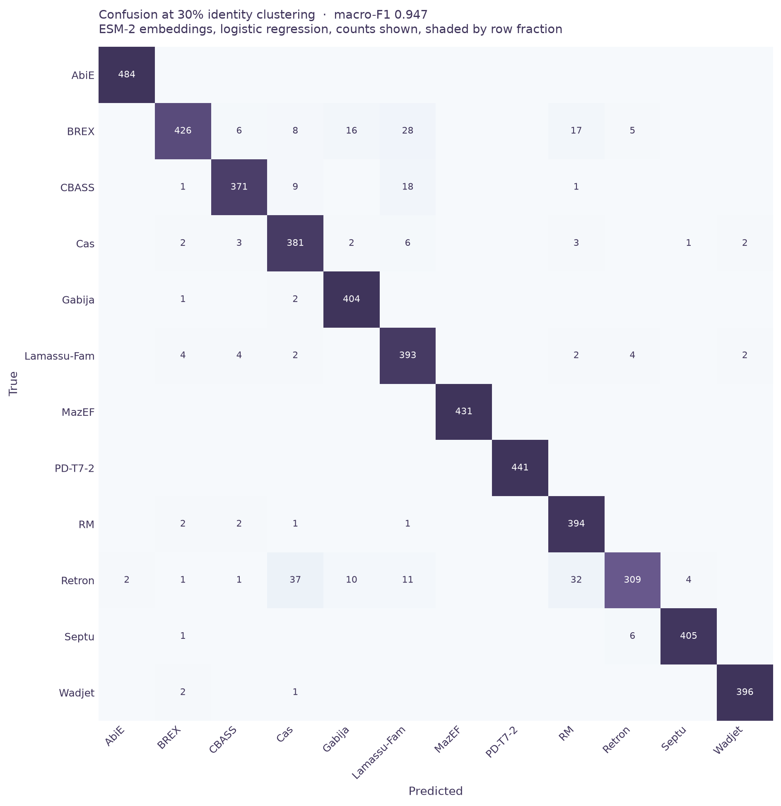
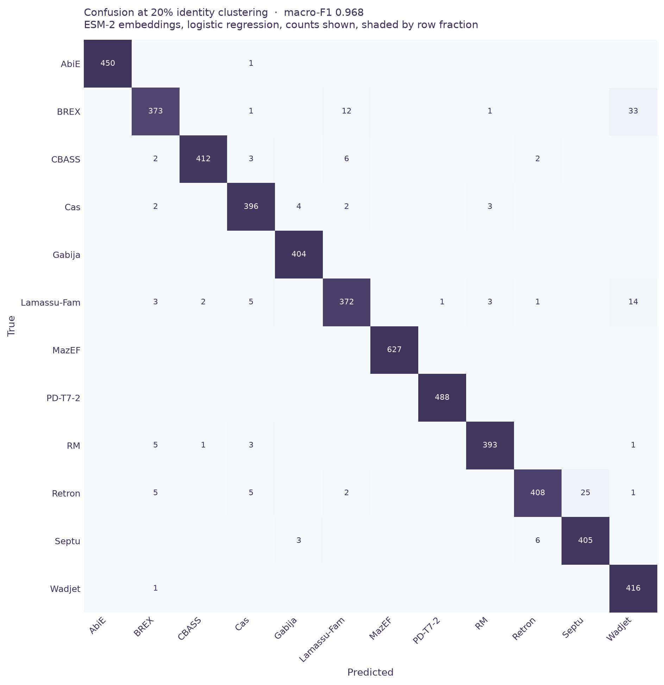

# Homology leakage in protein language model benchmarks

**Do ESM-2 embeddings classify bacterial antiphage defence proteins because they
understand the proteins, or because they recognise sequences they have already
seen?**

Mostly the former — and the cheap baseline they are usually compared against is
the one doing the recognising.

On twelve-way defence system family classification, removing homologs from the
test set costs ESM-2 embeddings **0.025 ± 0.008** macro-F1 and costs 3-mer
composition **0.235 ± 0.026**, nearly ten times more. Most of what the k-mer
baseline appeared to know was sequence-similarity leakage.

On a second task where the classes are *not* homologous families, no method
shows a meaningful gap. The measurement finds leakage where leakage exists and
stays quiet where it does not.



## Why this needs checking

Protein families are, by definition, sets of similar sequences. Split a protein
dataset at random and near-identical sequences land on both sides of the
train/test boundary, so a model can score well by matching against something it
has already memorised. The published number then measures recall of the
training set rather than generalisation.

The standard correction is to cluster by sequence identity and assign whole
clusters to one side. This repo does that, reports both splits side by side so
the size of the correction is visible, and repeats the cluster-to-split
assignment across ten seeds so the correction comes with an error bar.

## Results

Macro-F1 on held-out test data, logistic regression on frozen features, mean ±
s.d. over 10 cluster-assignment seeds, clustering at 20% identity.

### Task A — defence system family (12 classes, homologous)

| Features | Random split | Clustered split | Leakage gap |
|---|---|---|---|
| ESM-2 150M embeddings | 0.987 ± 0.001 | 0.963 ± 0.007 | **0.025 ± 0.008** |
| 3-mer composition | 0.733 ± 0.006 | 0.498 ± 0.023 | **0.235 ± 0.026** |
| Amino-acid composition | 0.467 ± 0.005 | 0.396 ± 0.017 | 0.071 ± 0.018 |

k-mer and ESM-2 gaps are separated by roughly eight standard deviations.

### Task B — defence vs background protein (2 classes, non-homologous)

| Features | Random split | Clustered split | Leakage gap |
|---|---|---|---|
| ESM-2 150M embeddings | 0.974 ± 0.002 | 0.954 ± 0.015 | 0.020 ± 0.015 |
| 3-mer composition | 0.762 ± 0.004 | 0.725 ± 0.015 | 0.037 ± 0.014 |
| Amino-acid composition | 0.739 ± 0.007 | 0.735 ± 0.012 | 0.004 ± 0.014 |

All three gaps overlap. There is no separation between methods here.

### Task B is a negative control, not a replication

The absence of an effect on Task B was predictable before running it, from the
clustering alone. Background proteins are a near-random slice of bacterial
proteomes and barely cluster: they contributed roughly 5,400 of the 7,538
clusters while making up a quarter of the sequences. For most of the Task B
data the clustered split is therefore already close to a random split, so there
is little leakage available to remove.

That makes Task B the useful control it is. A leakage-detection procedure that
fired on every task would be measuring task difficulty, not leakage. This one
fires on the homologous task and stays quiet on the non-homologous one.

It is **not** independent evidence that embeddings resist leakage better than
k-mers. On Task B the ordering is not resolvable — read singly, one split even
puts them in a different order, which is exactly the kind of noise the
ten-seed procedure exists to catch.

### A second finding, about precision rather than accuracy

Random splits do not only inflate the score. They also make it look more
precise than it is. Standard deviations across seeds, Task A:

| Features | Random split | Clustered split |
|---|---|---|
| ESM-2 | 0.001 | 0.007 |
| 3-mer | 0.006 | 0.023 |
| Amino-acid | 0.005 | 0.017 |

Three to seven times tighter under random splitting. A single random-split
number would look reproducible to three decimal places while being wrong in the
first.

### Where the errors fall

Confusion matrices below are from the earlier defence-only clustering (before
background proteins were added), at both thresholds. Counts are shown; shading
is the row fraction.





Three classes are essentially solved at both thresholds: MazEF (F1 1.000),
PD-T7-2 (1.000 / 0.999), AbiE (0.998 / 0.999).

**The same two classes are hardest at both thresholds**, which is the point:

| Class | Recall at 30% | Recall at 20% |
|---|---|---|
| Retron | 0.759 | 0.915 |
| BREX | 0.842 | 0.888 |
| *(all others)* | ≥ 0.927 | ≥ 0.928 |

At 30%, Retron loses 37 proteins to Cas and 32 to RM; BREX loses 28 to
Lamassu-Fam, 17 to RM and 16 to Gabija.

These are not random failures, and they are not an artifact of where the
clustering threshold was drawn — they survive it. They fall between systems
that share protein domain families: BREX and RM both carry methyltransferases;
retrons are built around a reverse transcriptase, and CRISPR-associated reverse
transcriptases exist. The model is confusing systems that are genuinely related
at the domain level, which is closer to correct behaviour being scored as error
than it is to a model guessing.

This matters for interpreting the headline number. If 0.963 came from residual
leakage or a label artifact, errors would be spread randomly or concentrated in
one class. Instead they track known protein homology, consistently.

### Why the stricter threshold scores higher

Overall macro-F1 on Task A was 0.947 at 30% identity and 0.968 at 20% (seed 0,
defence-only clustering). A stricter clustering producing a better score looks
backwards, and the explanation is worth stating rather than hiding.

Coarser clustering does not only remove homologs from the test set. It also
makes that set less diverse. Going from 3,559 clusters to 2,163 means the
held-out data is assembled from fewer independent blocks, so each class's test
sequences are more similar to one another and easier to classify once the
family is recognised at all.

Stricter clustering is therefore not automatically a harder test. **The 30%
number is the more conservative estimate**, and the 20% run should be read as a
check that the ranking of methods is stable rather than as a tighter bound on
performance.

## What this does not show

**The prediction going in was the opposite.** The expectation was that
embeddings, encoding family identity, would be the most exposed to homology
leakage, and that simple composition features would degrade least. That was
wrong in both direction and magnitude. It is recorded here because a hypothesis
that failed is more informative than one never written down.

**It is not evidence that ESM-2 beats profile HMMs.** No HMM baseline is
included, deliberately: the class labels were produced by DefenseFinder's HMMs,
so scoring HMMs against them would be close to circular. The comparison here is
between feature representations under identical conditions, not a claim about
the best available annotation tool.

## Data

Labels come from the [DefenseFinder](https://defensefinder.mdmlab.fr/) RefSeq
precomputed database — DefenseFinder run over the complete bacterial RefSeq
genomes, snapshot May 2022. The export contains 152,386 defence systems; after
deduplication that is 198,358 unique proteins.

Sequences are fetched from NCBI by accession. Of 23,789 requested, 23,770
resolved — the rest were suppressed or replaced since the 2022 snapshot.

The 12 most abundant system types are kept and **capped at 2,000 proteins each**
(PD-T7-2 has only 1,789). The cap is deliberate: the raw distribution runs from
64,481 RM proteins to 1,789 PD-T7-2, a 36:1 ratio under which macro-F1 is
dominated by sampling noise in the small classes. It also keeps the embedding
pass tractable on CPU.

**Background proteins** for Task B are sampled from 60 of the same genomes the
defence proteins came from — 250,411 candidates, subsampled to 8,000. Sampling
from the same genomes matters: drawn from unrelated taxa, the two classes could
be separated on GC-driven amino-acid bias alone and the task would measure
nothing.

Final dataset: **23,770 defence proteins across 12 system types** — AbiE, BREX,
CBASS, Cas, Gabija, Lamassu-Fam, MazEF, PD-T7-2, RM, Retron, Septu, Wadjet —
plus **8,000 background proteins**.

## Method

**Embeddings.** `esm2_t30_150M_UR50D`, final-layer residue representations
mean-pooled over the sequence, 640 dimensions. Computed once and cached;
sequences truncated to 1,022 residues. About 13 hours total on 4 CPU cores.

**Clustering.** MMseqs2 `easy-cluster`, 80% coverage, sensitivity `-s 7.5`.
MMseqs2's default prefilter does not reliably find matches below ~30% identity,
and without raising sensitivity a nominal 20% run returns almost the same
clusters as 30%.

| Set | Identity | Clusters | Largest | Median |
|---|---|---|---|---|
| defence only (23,770) | 30% | 3,559 | — | — |
| defence only (23,770) | 20% | 2,163 | 537 | 2 |
| with background (31,770) | 20% | 7,538 | — | — |

The defence-only distribution — a few very large conserved families alongside a
long tail of pairs — is why repeated seeds are necessary. A 537-member cluster
is 2.3% of that dataset moving between train and test as a single block.

**Splitting.** Whole clusters are assigned to one side only, stratified by class:
clusters are grouped by their majority system type (or by `background`) and
filled per class to the target proportions. A naive largest-first assignment was
tried first and left four of twelve classes with **zero** test examples, which
makes macro-F1 meaningless — the stratification is load-bearing, not cosmetic.

**Evaluation.** Logistic regression and a small MLP on standardised frozen
features. 70/10/20 train/val/test. Macro-F1, because the question concerns all
classes equally.

## Reproducing

```bash
conda create -n dplm python=3.11 -y && conda activate dplm
conda install -c bioconda -c conda-forge mmseqs2 ncbi-datasets-cli -y
pip install -r requirements.txt
```

Download the RefSeq export from https://defensefinder.mdmlab.fr/wiki/refseq/
into `data/raw/`, set `ENTREZ_EMAIL` in `src/config.py`, then:

```bash
python src/fetch_annotations.py   # parse labels, cap per class
python src/build_dataset.py       # fetch sequences from NCBI (~5 min)
python src/build_background.py    # Task B background set (~10 min)
python src/make_splits.py         # MMseqs2 clustering, both splits
python src/embed.py               # ESM-2 pass — ~13 h CPU, minutes on GPU
python src/train_eval.py          # single-split results, both tasks
python src/repeat_eval.py         # 10-seed means and spreads
python src/confusion.py           # per-class reports, every threshold on disk
python src/make_figures.py
```

`embed.py` caches every 2,000 sequences and skips what it already has, so it is
safe to interrupt and resume, and adding new sequences only embeds the new ones.

To add a clustering threshold, change `CLUSTER_IDENTITY` in `src/config.py` and
rerun `make_splits.py`; each threshold gets its own directory and `confusion.py`
picks up every one it finds. Note that `make_splits.py` reuses an existing
clustering if present — delete the directory when the sequence set changes.

## Limitations

- **Labels are predictions, not ground truth.** DefenseFinder assigns them by
  HMM search. Mislabelled proteins propagate silently, and anything
  DefenseFinder cannot recognise is absent from the dataset entirely.
- **Background proteins are assumed non-defence** because DefenseFinder did not
  flag them. Some are certainly unrecognised defence proteins, which puts a
  ceiling on Task B.
- **Clustering at 20% identity is near MMseqs2's practical limit.** It is a
  robustness check on the 30% result, not a stronger ground truth.
- **One model, one pooling strategy.** Mean-pooling over residues is the common
  default but discards positional structure; other pooling choices, other model
  sizes, and fine-tuning are untested here.
- **Twelve classes, subsampled.** Results may not extend to rare system types or
  to the full 152-type vocabulary.
- **Clusters are assigned by majority type.** A cluster spanning several classes
  is balanced once rather than for each, which slightly loosens per-class
  proportions.
- **Task B is unbalanced** at 23,770 defence to 8,000 background, a compute
  compromise. Macro-F1 handles the imbalance but a balanced set would be
  cleaner.
- **The confusion matrices predate the background set** and use the defence-only
  clustering, so they are not directly comparable to the Task A numbers in the
  results tables above.

## Layout

```
src/        pipeline scripts, run in order
data/       downloaded and derived data (gitignored)
results/    metrics tables and figures
```

| File | Contents |
|---|---|
| `results/repeats_id0.2.csv` | per-seed macro-F1 for both tasks — the numbers behind every table here |
| `results/summary.csv` | single-split results, all tasks, features and classifiers |
| `results/report_id30.csv`, `report_id20.csv` | per-class precision, recall, F1 |
| `results/confusion_id30.csv`, `confusion_id20.csv` | confusion matrices as counts |
| `results/taskA_only/` | results from before the background set was added |
| `results/id30/` | the earliest 30%-identity single-split run |

## Colour

Figures use a palette adapted from a *Nature* cover. The scheme's blue and pink
are not used together: their separation under red-green colour blindness is
ΔE 3.9 against a usable floor of 8, so they are indistinguishable to a
substantial fraction of readers. The violet and green pair used instead clears
both the colour-vision-deficiency and normal-vision thresholds.
